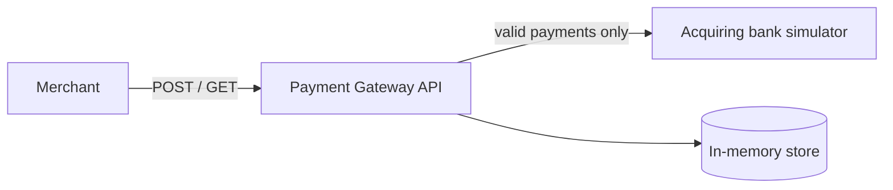

# Payment Gateway

An ASP.NET Core (.NET 8) API that lets a merchant process a card payment through an acquiring bank and retrieve it later.



## Running it

### With Docker (API and bank together)

```sh
docker compose up -d --build
```

- Swagger UI: http://localhost:5080/swagger
- Health check: http://localhost:5080/health

Stop everything with `docker compose down`.

### With the .NET 8 SDK

```sh
docker compose up -d bank_simulator
dotnet run --project src/PaymentGateway.Api
```

Swagger UI is at https://localhost:7092/swagger.

### Tests

```sh
dotnet test
```

The tests that call the real bank simulator are skipped when it isn't running. Start it with `docker compose up -d bank_simulator` to include them.

## Using the API

### Process a payment

`POST /api/payments`

```json
{
  "cardNumber": "2222405343248877",
  "expiryMonth": 4,
  "expiryYear": 2027,
  "currency": "GBP",
  "amount": 100,
  "cvv": "123"
}
```

`amount` is in minor units, so `100` is £1.00.

```json
{
  "id": "6b9d4c67-426f-4dc5-8cf3-8e032ad47dd4",
  "status": "Authorized",
  "cardNumberLastFour": "8877",
  "expiryMonth": 4,
  "expiryYear": 2027,
  "currency": "GBP",
  "amount": 100
}
```

| Response | When |
|---|---|
| `201` with status `Authorized` or `Declined`, and a `Location` header | The bank processed the payment |
| `400` with status `Rejected` and a list of errors | The request is invalid. The bank is not called and nothing is stored |
| `502` | The bank is unavailable. Nothing is stored, so it is safe to try again |

With the simulator, a card number ending in an odd digit is authorized, 2, 4, 6 or 8 is declined, and `0` makes the bank unavailable.

### Retrieve a payment

`GET /api/payments/{id}` returns the same fields as above, or `404` if the ID is unknown.

## How it's structured

| Part | Job |
|---|---|
| `PaymentsController` | HTTP in and out |
| `PaymentService` | Validate, call the bank, store the result |
| `PaymentRequestValidator` | The validation rules from the brief |
| `BankClient` | Calls the bank simulator and turns any failure into `BankUnavailableException` |
| `PaymentsRepository` | In-memory storage |
| `PaymentMetrics` | Counts payments by outcome |

## Observability

- **Logs:** every payment logs its outcome: processed (with ID and status), rejected (with the number of errors), or bank unavailable (with the exception). Card numbers and CVVs are never logged. In Docker, follow them with `docker logs -f payment_gateway`.
- **Metrics:** a `payments.processed` counter on the `PaymentGateway.Api` meter, tagged with `outcome` (`authorized`, `declined`, `rejected`, `bank_unavailable`). To watch it live while running with `dotnet run`:
  ```sh
  dotnet tool install -g dotnet-counters
  dotnet-counters monitor -n PaymentGateway.Api --counters PaymentGateway.Api
  ```
- **Health:** `GET /health` returns `Healthy` when the API is up. It doesn't check the bank.
- **Trace IDs:** error responses include a `traceId`, so a merchant can quote it when reporting a problem.

## Design decisions

- **Rejected payments aren't stored.** They never reach the bank, so there is no payment to retrieve. The `400` response says `Rejected` so the merchant can tell it apart from a decline.
- **Only the last four card digits are stored.** The full card number and CVV go to the bank and are never kept, in line with PCI DSS. The bank's authorization code isn't stored either, because nothing in the API returns it.
- **Bank failures return `502`.** Timeouts, connection errors, error status codes and unreadable replies are all treated as "bank unavailable". The gateway doesn't retry, because without idempotency a retry could charge the card twice.
- **Bank calls aren't cancelled if the merchant disconnects.** Cancelling our request doesn't cancel the bank's. If it did, a payment could be authorized at the bank but never stored by us.
- **Validation choices:**
  - The expiry date is checked in UTC, and a card is valid until the end of its expiry month.
  - Currency must be `GBP`, `USD` or `EUR` in uppercase.
  - The amount must be greater than zero.
- **Unreadable request bodies get ASP.NET's default `400`.** Missing fields are reported by our validator in the `Rejected` format. Broken JSON, or a wrong type like `"amount": 10.5`, is rejected by ASP.NET before it reaches our code, and gets ASP.NET's standard error format instead. No payment is created either way. I kept the default to keep the code simple.
- **Stored payments are separate from API responses.** `Payment` is what we store and `PaymentResponse` is what merchants see, so storage can change without changing the API.
- **POST returns `201 Created`** with a `Location` header pointing at the new payment, and Swagger documents every response type.
- **Storage is in memory.** It's thread-safe, but data is lost on restart. A database could replace it behind `IPaymentsRepository` without changing anything else.

## Testing

- Unit tests cover the validator, bank client, repository and payment service.
- API tests run the whole app in memory with a fake bank, and check status codes, the JSON shape and card masking.
- Simulator tests send real payments through the API to the bank simulator (authorized, declined, bank unavailable). They are skipped when the simulator isn't running, so `dotnet test` never depends on Docker.

## What I'd add for production

- Merchant authentication, so a merchant can only see its own payments.
- Idempotency keys, so a merchant can safely retry a payment.
- A database instead of in-memory storage.
- Stricter checks on the bank's reply, for example an authorized payment with no authorization code.
- A health check that also reports whether the bank is reachable.
- Metrics and traces exported to a monitoring system (for example with OpenTelemetry) instead of only being available locally.
- HTTPS inside the container. It currently serves HTTP and expects TLS to be handled in front of it, for example by a load balancer.
